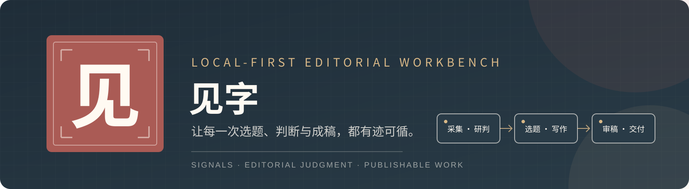
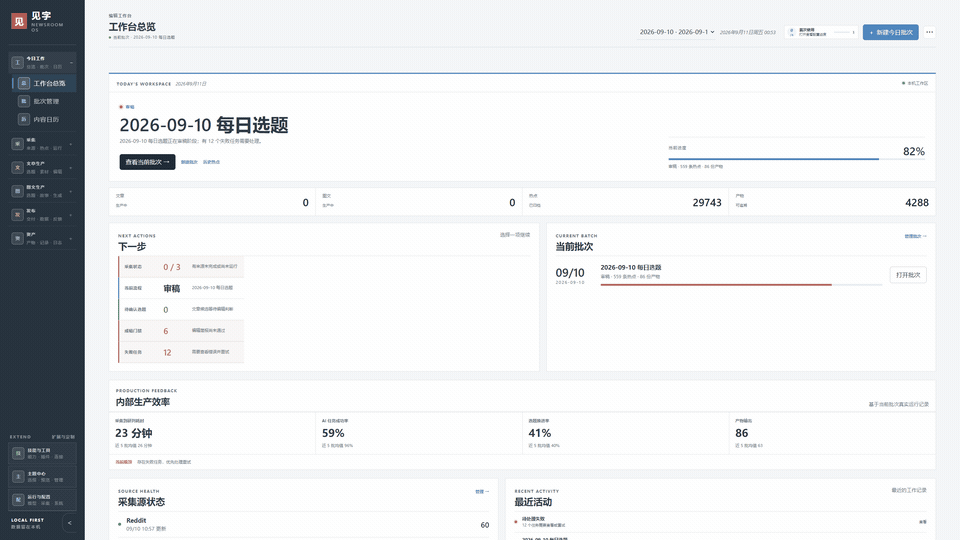

  

# 见字 · WeChat Editorial Workbench

[中文](./README.md) · [English](./README.en.md)

<strong>A local-first editorial workbench that takes a WeChat story from signal to publishable output.</strong>

If you are tired of copying sources, decisions, and drafts between browser tabs and chat histories, 见字 keeps them together in one local editorial workflow:

Discover <strong>→</strong> investigate <strong>→</strong> decide <strong>→</strong> write <strong>→</strong> review <strong>→</strong> format <strong>→</strong> deliver

  
  
  

  

  <a href="https://github.com/shiker1996/wechat-editroom/releases/latest">Download the Windows app</a> ·
  <a href="https://wechat-newsroom-guide.vercel.app/">Take the online tour</a> ·
  <a href="https://github.com/shiker1996/wechat-editroom/issues">Report an issue</a>

## Who is it for?

- Creators who publish regularly and want more than one-off AI drafts.
- Small editorial teams that need sources, decisions, drafts, and deliverables in one place.
- Writers who want articles, covers, social cards, and formatting in one repeatable flow.

## What can it do?

### Start with signals, not a blank prompt

Connect RSS, RSSHub, Reddit, GitHub, or web sources and bring useful signals into one workspace. Sources can be tested, paused, and tracked.

### Let AI help with judgment while you keep editorial control

Labels, events, fact cards, audience relevance, and candidate topics are kept as separate steps. You can see why a topic was selected, what it is based on, and where to change direction.

### Go from topic to deliverable

Writing, review, SEO, WeChat HTML, covers, charts, and paged social cards live in the same workspace. Outputs, versions, and failed stages remain inspectable.

### Work like a desktop app

The Windows app provides a native window, menus, shortcuts, a first-run guide, and a selectable runtime data directory. Your workspace stays local by default; large external dependencies such as RSSHub are enabled when needed.

## Spend less time copying, keep more of the editorial trail

ChatGPT and other model tools can still be part of your workflow. 见字 connects the sources, editorial decisions, writing, and delivery steps:

| Typical workflow | 见字 |
|---|---|
| Copy signals and sources between websites | Keep sources, events, facts, and topics together |
| Rely on chat history to remember decisions | Preserve editorial reasoning by stage |
| Find separate tools for formatting and visuals | Keep HTML, covers, and social cards in one cabinet |
| Start over when something fails | Trace runs, versions, and failure stages |

## Start in five minutes

1. Download the latest Windows installer from [GitHub Releases](https://github.com/shiker1996/wechat-editroom/releases/latest).
2. Install and launch 见字, then choose a workspace and follow the in-app setup.
3. Add an RSS/Atom source and test the connection.
4. Create today’s batch and collect items for review.
5. Draft an article, then format it or create social cards when ready.

The Windows desktop app does not require a separate Node.js installation. You can start with an RSS/Atom source and add RSSHub, Chrome, and other optional tools later. If you use Codex, WorkBuddy, or DeepSeek Harness, follow the [Agent setup guide](./docs/agent-usage-guide.md); these workflows use the model in your current agent session, so you do not need to configure a separate 见字 model.

> The desktop installer currently targets Windows 10/11 x64. macOS and Linux can run the source workflow experimentally, but desktop installers are not published yet.

## Use 见字 with Codex, WorkBuddy, and DeepSeek Harness

见字 can run on its own or serve as a local content workbench for an external agent. Through [MCP and project Skills](./docs/agent-usage-guide.md), compatible local MCP clients such as Codex, WorkBuddy, DeepSeek Harness, and Kimi can read the account profile and sources, start collection, inspect research results, and submit formatted articles, covers, and social cards for storage and validation.

The external agent uses its current session model for analysis and generation. 见字 stores article documents; its optional local article audit only reports structure, length, and title-risk reminders, and does not replace fact-checking or editorial review. Typeset, cover, and social-card submissions run their corresponding structure/content checks; social cards also support browser visual audits, screenshots, and archiving. This workflow does not require a separate 见字 model configuration. Codex and WorkBuddy have project-level install commands; DeepSeek Harness, Kimi, and other MCP clients can connect through the local `stdio` server and load the project Skills using their own client settings.

1. Install and start 见字. Keep the workbench and agent client on the same computer.
2. From the project root, run `npm run jianzi -- install --agent codex` or `--agent workbuddy`. For other MCP clients, add `scripts/agent-integration/mcp-server.mjs` as a local `stdio` server using the Node.js runtime for this project.
3. Load the project Skills from `agent-integrations/skills/`, refresh the MCP connection, and call `jianzi_doctor` to verify connectivity.
4. Follow the [agent setup and usage guide](./docs/agent-usage-guide.md) to configure the account profile and sources, then run the content workflow.

To use built-in AI from the 见字 interface, configure a model under Runtime & Configuration. This is independent from external agent access.

## See it before installing

Open the [online tutorial and read-only tour](https://wechat-newsroom-guide.vercel.app/) to see the dashboard, topic pools, article editor, and social-card workspace first.

The tour uses reviewed, de-identified demo data. It does not need a model key and does not connect to your local workspace.

## Local-first, not “completely offline”

Workspace data, articles, images, logs, and run records stay on your machine by default. Data is sent to a configured model, search, collection, image, or CDN service only when the corresponding task needs it.

见字 is designed for a trusted local user, not public multi-user hosting. AI output still needs human review for facts, sources, copyright, and publishing risk.

## Project status

- Windows desktop app: primary release and validation platform.
- Writing, WeChat formatting, covers, and social-card production: actively evolving.
- macOS / Linux: experimental source support; no desktop installers yet.

## For contributors

If you want to run the source workflow or contribute to the project, start with:

- [User guide](./docs/user-guide.md): setup, configuration, collection, writing, social cards, and troubleshooting.
- [Desktop guide](./docs/desktop.md): Electron development, packaging, and release.
- [Documentation index](./docs/README.md): configuration, architecture, plugins, data flow, and security.

Source development requires Node.js 24+. Those commands are kept in the documentation so they do not become a prerequisite for normal users.

## License

MIT. See [THIRD_PARTY_NOTICES.md](./THIRD_PARTY_NOTICES.md) for third-party materials and licenses.
