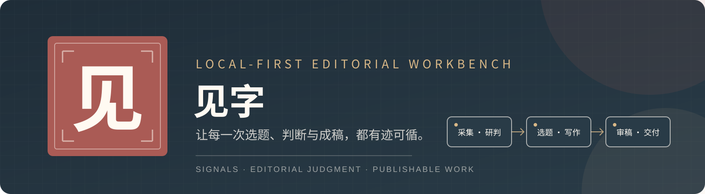

  

# 见字 · 公众号编辑工作台

[中文](./README.md) · [English](./README.en.md)

<strong>把找热点、选题、写稿和排版放进同一条可回看的工作流程。</strong>

如果你经常在浏览器、聊天记录和排版工具之间来回复制，见字可以把来源、编辑判断、文章和交付物放回同一张本地工作台：

找热点 <strong>→</strong> 研判事实 <strong>→</strong> 做编辑决策 <strong>→</strong> 写稿 <strong>→</strong> 审稿 <strong>→</strong> 排版 <strong>→</strong> 交付文章、封面与图文

  
  
  

  <a href="https://github.com/shiker1996/wechat-editroom/releases/latest">下载 Windows 桌面版</a> ·
  <a href="https://wechat-newsroom-guide.vercel.app/">查看真实界面</a> ·
  <a href="https://www.bilibili.com/video/BV1KjYj6GEJU">观看 B 站教程 ↗</a> ·
  <a href="https://github.com/shiker1996/wechat-editroom/issues">反馈问题</a>

## 它适合谁？

- 想持续做公众号，而不是偶尔让 AI 代写一篇文章的作者。
- 需要把热点、来源、判断、稿件和交付物放在一起管理的内容团队。
- 想把文章、封面、小红书图文和排版流程统一起来的个人创作者。

## 你可以用它做什么？

### 从热点开始，而不是从空白输入框开始

连接 RSS、RSSHub、Reddit、GitHub 或网页来源，把值得关注的信息收进工作区。每个来源都可以测试、暂停和追踪最近采集结果。

### 让 AI 参与判断，但把编辑权留给你

热点打标、事件聚类、事实卡、受众相关度和候选选题会分阶段保存。你可以知道一篇文章为什么被选中、依据了哪些来源，也可以在关键节点停下来修改方向。

### 从选题一直走到可交付产物

文章生产、审稿、SEO、公众号 HTML、封面图、Mermaid / ECharts 图表和逐页图文都在同一个工作区完成，产物、版本和失败原因都能回看。

### 像桌面软件一样工作

Windows 桌面版提供原生窗口、菜单、快捷键、首次使用引导和可选运行数据目录。文章、图片与日志默认保存在本机；RSSHub 等较大的外部依赖按需启用，不会在安装时一次性下载。

## 少一些来回复制，多一些可追溯的编辑过程

见字可以和 ChatGPT 等模型工具配合使用；它补上了信息来源、编辑判断和文章交付之间的衔接：

| 传统做法 | 见字 |
|---|---|
| 在多个网站之间复制热点和来源 | 信息源、热点、事实和选题集中管理 |
| 依靠聊天记录记住为什么选这个题 | 编辑判断和事实依据按阶段留下 |
| 写完文章后再手动找工具排版、做图 | 文章、HTML、封面和图文进入同一个产物柜 |
| 出错后只能重新来一遍 | 任务日志、版本和失败阶段可以追踪 |

## 五分钟开始

1. 从 [GitHub Releases](https://github.com/shiker1996/wechat-editroom/releases/latest) 下载 Windows 安装包。
2. 安装并启动，按应用内引导设置工作区和模型。
3. 添加一个 RSS/Atom 来源，先测试连接。
4. 创建今天的批次，完成采集和选题。
5. 生成文章草稿，确认后再排版或制作图文。

Windows 桌面版不需要单独安装 Node.js。你也不必一开始装齐所有采集器：先用 RSS/Atom 跑通流程，RSSHub、Chrome 等能力等需要时再添加。使用 Codex、WorkBuddy 或 DSH 时，可直接按 [Agent 接入指南](./docs/agent-usage-guide.md)操作；默认使用 Agent 当前会话模型，不需要另配见字模型。

> 当前桌面安装包优先支持 Windows 10/11 x64。macOS 和 Linux 可以运行源码版本，但暂未提供对应桌面安装包。

## 也可以让 Codex、WorkBuddy 等 Agent 操作见字

见字既可以独立运行，也可以作为本机内容工作台接入外部 Agent。通过 [MCP 与项目 Skills](./docs/agent-usage-guide.md)，Codex、WorkBuddy、DeepSeek Harness、Kimi 等支持本机 MCP 的 Agent 客户端可以读取账号画像和采集源、发起采集、查看研判结果，并把文章排版、封面和图文产物交给见字保存与校验。

外部 Agent 使用当前会话的模型完成分析和生成。见字保存文章文档；可选的文章本地审计只提供结构、长度和标题风险提醒，不替代事实核验或审稿。排版、封面和图文提交会执行对应的结构/内容校验，图文还支持浏览器视觉审计、截图和归档。走外部 Agent 路径不需要再配置一套见字内部模型。Codex 和 WorkBuddy 有项目级安装命令；DeepSeek Harness、Kimi 等客户端可通过 MCP 的本机 `stdio` 服务连接，并按客户端方式加载项目 Skills。

1. 安装并启动见字工作台，保持工作台和 Agent 客户端在同一台电脑上运行。
2. 在项目根目录运行 `npm run jianzi -- install --agent codex` 或 `--agent workbuddy`；其他 MCP 客户端按其设置添加 `scripts/agent-integration/mcp-server.mjs`，命令为项目使用的 Node.js。
3. 在客户端加载 `agent-integrations/skills/` 中的项目 Skills，刷新 MCP 连接，并调用 `jianzi_doctor` 确认连通。
4. 让 Agent 按 [接入与操作指南](./docs/agent-usage-guide.md)配置账号画像、采集源并完成内容流程。

如果只想在见字界面中使用内置 AI，仍可在“运行与配置”里配置模型；外部 Agent 接入与这项设置相互独立。

## 先看效果

不想先安装？打开[在线教程与真实界面展示](https://wechat-newsroom-guide.vercel.app/)，先看看热点、选题池、文章编辑器和图文工作区。

## 本地优先，但不是“完全离线”

见字的工作区、文章、图片、日志和运行记录默认保存在本机。只有在你配置并使用模型、搜索、采集、图片或 CDN 服务时，相关任务输入才会发送给对应服务。

它适合可信的本机用户，不是面向公网的多人 SaaS。AI 生成内容仍需要人工确认事实、来源、版权和发布风险。

## 项目状态

- Windows 桌面版：当前主要发布和验证平台。
- 文章生产、公众号排版、封面和社交图文：持续完善中。
- macOS / Linux：源码实验性支持，桌面安装包暂未提供。

## 给开发者

如果你想运行源码、接入 Agent 或了解扩展方式，请看：

- [详细使用手册](./docs/user-guide.md)：安装、配置、采集、写作、图文和排障。
- [移动端使用说明](./docs/mobile-access.md)：通过私有网络在手机上访问家中电脑上的工作台。
- [桌面版说明](./docs/desktop.md)：Electron 开发、打包与发布。
- [完整文档索引](./docs/README.md)：配置、架构、插件、数据流和安全边界。

源码开发需要 Node.js 24+，具体命令和环境准备放在文档中，不作为普通用户的安装前置条件。

## 许可证

代码采用 [MIT License](./LICENSE)。第三方材料与许可证见 [THIRD_PARTY_NOTICES.md](./THIRD_PARTY_NOTICES.md)。“见字”名称和印章样式仅用于标识本项目官方版本，衍生产品不得暗示官方关联或背书。
