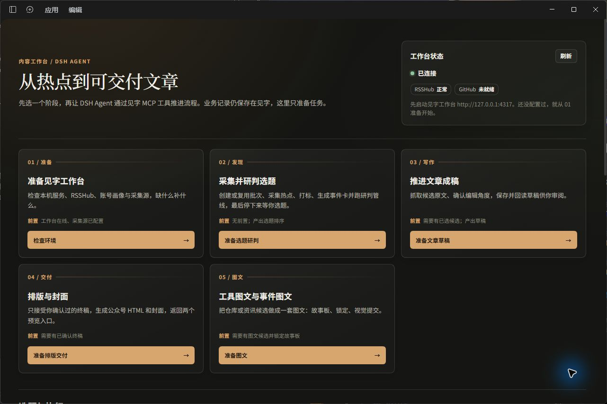

# 见字 DSH 内容工作台

在[官方 DeepSeek Harness 桌面应用](https://github.com/deepseek-ai/deepseek-harness)里安装见字插件，把找选题、写文章、看内容日历和打开交付物放在一个入口中。按钮会先准备一条会话草稿；你检查并发送后，DSH Agent 再通过见字 MCP 工具执行。文章仍由当前 DSH 会话模型生成，业务记录保存在本机见字项目。



## 安装和开始使用

1. 打开官方 DeepSeek Harness 桌面应用的「插件 → 添加插件」。
2. 输入 `jianzi-content-workbench` 并安装。
3. 在已安装插件中启用见字内容工作台；若提示重启，按提示重启或重新加载。
4. 打开见字项目作为 DSH 当前会话的工作空间，并确认见字服务在本机运行。
5. 打开「见字内容工作台」，选择阶段和批次，检查自动准备的会话草稿后发送。

未连接时，可从状态卡准备启动任务。启动操作需要当前 DSH 会话能识别所选工作空间的本机绝对路径；如果项目目录尚不存在，请先通过检查环境流程确认初始化方案。启动不会自动克隆项目或安装 RSSHub。

**常见问题**

- **需要单独配置见字模型吗？** 不需要。默认使用当前 DSH 会话模型；见字内部模型仅用于明确选择见字自己的 AI 生成工具。
- **按钮会直接执行任务吗？** 不会。按钮只生成草稿，检查后由你发送。
- **安装时需要找插件市场吗？** 不需要。在「添加插件」中直接输入 npm 包名 `jianzi-content-workbench`。

更多连接与客户端设置见[Agent 接入指南](../../docs/agent-usage-guide.md)。

## 六段流程

| 阶段 | 面板动作 | 对应技能 / 门禁 |
| --- | --- | --- |
| 01 准备 | 检查环境 | `jianzi-workbench-setup`：工作台在线、RSSHub、账号画像、采集源；RSSHub 未装时给出手动步骤 |
| 02 发现 | 准备选题研判 | `jianzi-topic-to-article`：批次、采集、打标、事件与事实卡、研判管线；产出排序并停下等用户选 |
| 03 写作 | 准备文章草稿 | 同技能文章阶段：抓原文、确认角度、保存 draft；不保存 final |
| 04 交付 | 准备排版交付 | `jianzi-typeset-cover`：只接受已确认终稿，生成 HTML 排版与封面，返回两个入口 |
| 05 图文 | 准备图文 | `jianzi-social-cards`：工具/事件候选、故事板、锁定、视觉提交 |
| 06 复盘 | 上传导出表格后生成反馈草案 | 先检查附件；没有表格就请用户上传并停止，不读取现有反馈或草案。收到表格后用内容反馈 MCP 导入、刷新快照并生成待确认草案；必须由用户明确确认后才应用 |

面板输入只有三项：补充要求、批次 ID（可选）、候选 ID（可选）。留空时由 Agent 先列出现有批次或候选。任务以未发送草稿的形式进入原生会话，用户检查后按发送才执行。工作台未连接时，状态卡会提供「准备启动任务」按钮；提示词要求 Agent 使用当前 DSH 会话选中的工作空间绝对路径作为 `projectRoot`，调用 `jianzi_workbench_start` 启动，并等待服务就绪和项目指纹校验。若本机没有有效项目目录，检查提示会先询问是否克隆到空目录，确认后才初始化；启动工具本身不会克隆或安装项目。

首页的六个阶段任务都带有统一的下一步约定：结果完成后只推荐一个具体动作，并给出可直接回复的候选 ID、确认语或预览入口。存在用户选择/确认门禁时会停下来等回复；不以泛泛的「还需要什么帮助吗」结束。

## 实现

- `lib/client.js`：官方 Client Slots（`sidebar.panellist` + `main`）注册侧栏入口和整页面板；点击按钮调用 `uiWorkspace.startSession` 写入任务草稿。
- `cordis.patch.yml`：用官方 `@deepseek-ai/dsh-mcp-client` 以 stdio 启动包内 `mcp-server.mjs`，DSH 暴露 `mcp__jianzi_workbench__jianzi_*` 工具。
- `mcp-server.mjs` + `shared/`：复用 `scripts/agent-integration/` 的工具定义、执行器与本机 API 客户端，默认 `http://127.0.0.1:4317`（`JIANZI_WORKBENCH_URL` 可覆盖）。
- DSH 中调用 `jianzi_workbench_start` 可启动已停止的本机项目并等待健康检查；通过 `projectRoot` 参数或 MCP 进程环境变量 `JIANZI_PROJECT_ROOT` 指定源码项目绝对路径。启动器复用项目内官方启动脚本，不会打开浏览器，并并行轮询就绪接口；服务有效响应后立即核对健康信息与项目指纹，避免启动器进程未退出造成误报。启动最多等待 90 秒，DSH MCP 单次调用上限为 120 秒。
- 面板文案不硬编码 MCP 工具名，也不复述流程细节；流程以项目技能为准，改流程只改技能。

## 面板读取的数据

面板不能调用 MCP 工具（那些注册在 Host 的模型工具表里）。读取能力由 Host 插件用同一套实现提供：

- `GET /jianzi/status` → `jianzi_doctor`（工作台连通、RSSHub、GitHub 状态）
- `GET /jianzi/batches?limit=8` → `jianzi_batches_list`
- `GET /jianzi/candidates?batch=<id>&track=article` → `jianzi_batch_candidates`（缺 batch 返回 400；`track=social_cards` 时读取图文候选）
- `GET /jianzi/social-ranking?batch=<id>` → `jianzi_batch_social_ranking`（图文选题、G_social、素材类型）
- `GET /jianzi/jobs?batch=<id>&limit=8` → `/api/jobs`（批次采集与后台任务执行情况）
- `GET /jianzi/calendar?month=YYYY-MM` → `jianzi_calendar_list`（内容日历：文章、已交付图文与写作计划）

DSH Agent 还可直接通过 MCP 工具 `jianzi_calendar_list` 读取内容日历，包含终稿文章、已交付图文和写作计划；可传 `month`（`YYYY-MM`）筛选月份。它复用见字现有 `/api/calendar` 查询，不修改日历。

内容反哺也通过首页「06 / 复盘」卡片和同一套 MCP 工具提供。点击卡片后，Agent 必须先检查本轮附件：没有公众号导出表格时，请用户上传并停止，不读取本地反馈、策略或已有草案，也不生成草案。收到表格后，导入工具会自动索引文章、匹配指标并刷新反馈快照/策略；用户请求生成草案时，Agent 在同一轮继续调用草案生成工具，不用用户再提示“下一步”。导入工具与 AI 草案生成保持分开，避免单次 MCP 调用超时。也可单独导入，工具会返回结构化 `next_action`。支持 CSV/TSV、旧版 XLS 原始文件，或 Agent 从附件完整提取的 CSV/TSV 文本；不支持 XLSX 二进制。文章指标表必须包含内容标题、发表日期、阅读人数、分享人数、阅读后关注人数等导入所需列。草案只保持待确认；应用工具才会写本地账号配置、标题技能或 Prompt。

Host 插件（`dsh/index.mjs`）通过官方 `ctx.webServer.register` 注册读取路由，供面板同源 `fetch` 使用；项目启动则通过 DSH 原生会话提示词调用 MCP 工具，不经过 Host 请求响应解析。提示词要求 Agent 从当前会话工作空间取得绝对路径并传给工具；MCP 子进程自身运行在 DSH profile 目录，不能用它的当前目录推断项目路径。

面板不再提供手填 ID 的输入框：点顶部「最近批次」chips 选择/取消批次，点「文章选题」列表选择/取消候选，顶部只显示当前选择并可一键清除。

选中批次后，面板下方的「选题与执行」区会显示三栏：批次状态与最近任务（`/jianzi/jobs`）、文章选题（按 F 分，点击填入候选 ID）、图文选题（按 G_social，标注工具/事件图文与资格状态）。

再往下是「内容日历」：按月展示文章、图文与写作计划，按日期分组并统计数量，可用 ‹ › 切换月份。

## 开发者本地构建

从仓库根目录运行：

```sh
node agent-integrations/dsh-workbench/build.mjs
cd agent-integrations/dsh-workbench
pnpm pack
```

本地 `.tgz` 安装适用于开发和调试；普通用户直接在插件管理器中输入 npm 包名即可。DSH 插件索引是另一种分发方式，目前未单独发布。详见官方[插件打包与发布说明](https://github.com/deepseek-ai/deepseek-harness/blob/master/docs/user/develop/basic/publish.md)及[插件索引说明](https://github.com/deepseek-ai/deepseek-harness/blob/master/docs/user/guide/plugin-market.md)。

MCP 服务入口路径在 patch 中按 profile 写死（当前 `profiles/desktop`）；在其他 profile 安装时需要同步修改。

## npm 正式发布

正式发布由仓库的 `Publish DSH plugin to npm` GitHub Actions 工作流执行。将插件 `package.json` 的版本更新并合入主分支后，推送对应标签 `dsh-plugin-v<版本号>`（例如 `dsh-plugin-v0.2.30`）。工作流会核对标签和包版本、构建、生成 `.tgz`、上传 GitHub Actions 产物，并将同一个 `.tgz` 发布到 npm。不要用普通 CI 提交触发发布。

首次版本已发布到 npm Registry，GitHub Actions 已配置 **Trusted Publisher**：用户 `shiker1996`、仓库 `wechat-editroom`、工作流文件名 `publish-dsh-plugin.yml`，并允许直接发布。后续推送匹配包版本的标签时，工作流会通过 OIDC 发布，无需长期 npm 发布令牌。
